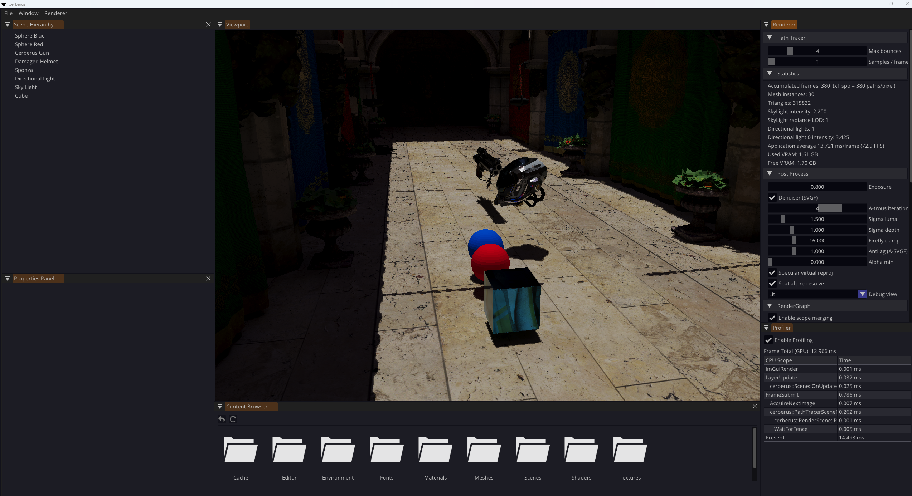
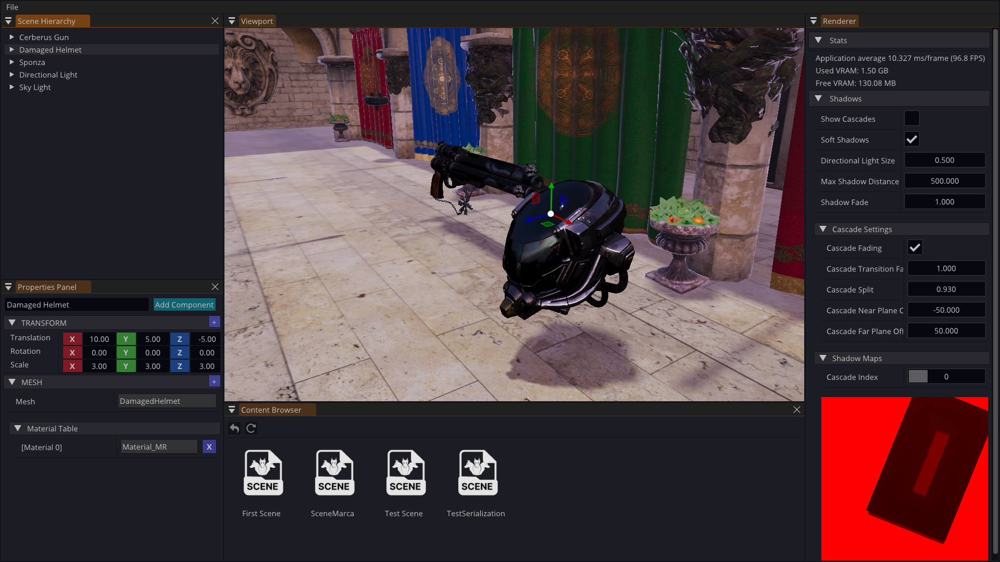
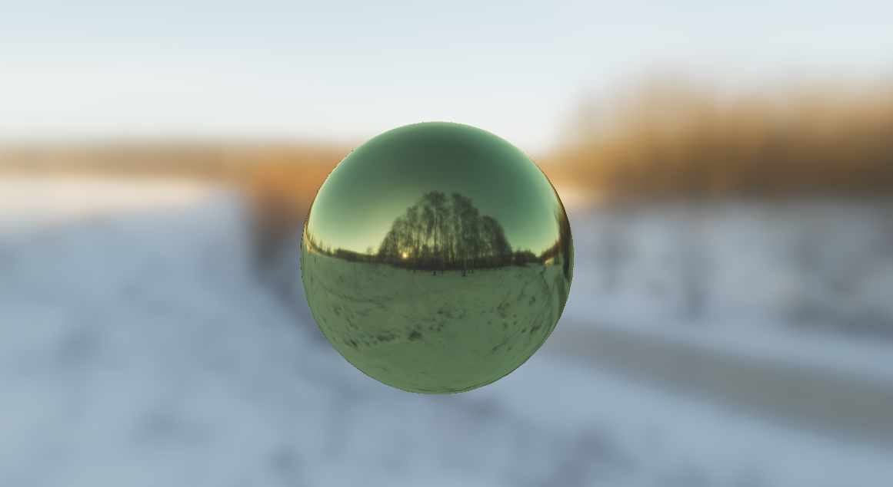
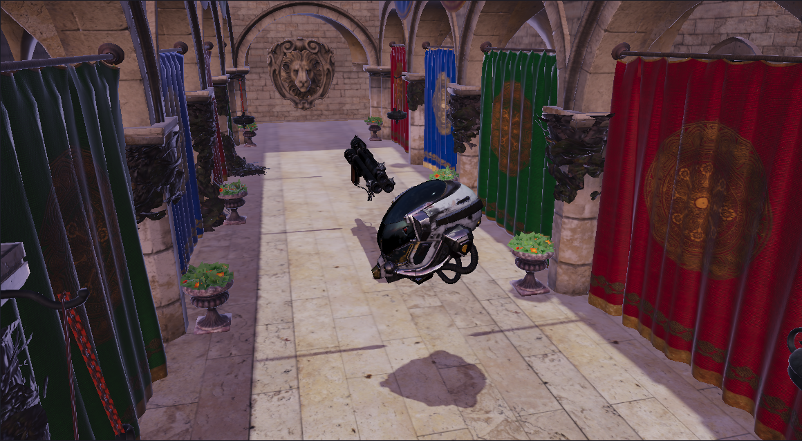

# Cerberus

Cerberus is a real-time Vulkan renderer and path tracer written from scratch in C++20. It has two scene renderers that you can switch between at runtime: a forward PBR rasteriser and a hardware ray-traced path tracer with an A-SVGF denoiser. Both run on a render graph that derives barriers automatically, over a thin Vulkan RHI.


*Path tracer at 1 spp with the A-SVGF denoiser, inside the Cerberus editor.*

## Highlights

### Path tracer (hardware ray tracing)
- Vulkan KHR ray tracing pipeline (raygen / closest-hit / miss) with BLAS/TLAS building and compaction, and a shader binding table.
- Bindless texture table for materials.
- 1 sample per pixel, configurable bounce count, BSDF-sampled indirect lighting and next-event estimation for directional lights.
- A reference accumulation mode for ground-truth comparison.

### A-SVGF denoiser
- Demodulated diffuse and specular signals (split by albedo and by the pre-integrated environment BRDF). Emissive and sky are kept raw and recombined in the finalize pass.
- Temporal reprojection:
  - Per-tap mesh, normal and plane consistency checks.
  - A ReLAX-style search fallback.
  - A-SVGF adaptive alpha driven by a temporal gradient (anti-lag).
- Virtual (reflected-ray) reprojection for specular, validated against a reflection G-buffer.
- A ReLAX-style history-fix pass for pixels with short history.
- Variance-guided à-trous filtering, plus an optional spatial pre-resolve and firefly clamping.

### Render graph
- Passes declare their reads and writes. The graph orders them with a topological sort and derives each barrier from the real per-frame access history.
- Consecutive graphics passes that share attachments are merged into a single Dynamic Rendering scope.
- Unreachable passes are culled. An ImGui panel shows per-pass GPU timings.
- The design was researched against Frostbite's FrameGraph, UE5's RDG and Granite. Design notes are in [`Cerberus/docs/RenderGraph.md`](Cerberus/docs/RenderGraph.md).

### Forward renderer
- PreDepth, shadow cascades, sky, forward PBR and composite passes.
- Image-based lighting baked on the GPU: equirectangular to cubemap, irradiance and prefiltered mips.

### Engine and RHI
- Thin Vulkan RHI with typed command lists (graphics, compute, transfer, ray tracing) and Dynamic Rendering.
- Handle-based resource ownership through a `ResourceManager`, plus a deferred resource-deletion queue.
- An asset pipeline that imports, serialises and caches meshes, materials and scenes, and an ImGui editor with scene hierarchy, properties panel, content browser and renderer/profiler panels.

## Gallery (forward renderer)

| Editor | Image-based lighting | PCSS shadows |
| --- | --- | --- |
|  |  |  |

## Architecture

The architecture is documented in [`Cerberus/docs/RendererArchitecture.md`](Cerberus/docs/RendererArchitecture.md):

```text
Editor / Application
  -> SceneRenderer (Forward | PathTracer; only the active one is alive)
       -> RenderGraph (declared access -> ordering, barriers, scope merging)
            -> Graphics / Compute / RayTracing command lists
                 -> Cerberus RHI -> Vulkan
```

## Building (Windows)

Requirements: Windows 10/11, Visual Studio 2022, the Vulkan SDK (with `VULKAN_SDK` set) and a GPU that supports `VK_KHR_ray_tracing_pipeline`.

```bat
git clone --recursive https://github.com/adrianrodriguesm/Cerberus-Engine.git
cd Cerberus-Engine\scripts
Setup.bat              :: checks Python / Vulkan SDK
Win-GenProjects.bat    :: generates the Visual Studio solution with premake
```

Then open `Cerberus.sln` and run `Cerberus-Editor`.

## Roadmap

These come from [`Cerberus/docs/PathTracerDenoiserGapAnalysis.md`](Cerberus/docs/PathTracerDenoiserGapAnalysis.md):

- Environment importance sampling, plus NEE and MIS for the skylight.
- Local and area lights.
- ReSTIR GI.
- Blue-noise / Sobol sampling.
- Transient resource aliasing and async compute in the render graph.

## Third-party

GLFW, Dear ImGui, ImGuizmo, spdlog, yaml-cpp, assimp, EnTT, glm, stb and shaderc.
Test scenes: Sponza and DamagedHelmet (Khronos glTF sample models) and the Cerberus gun model by Andrew Maximov. Check each asset's licence before redistributing it.

## License

Apache 2.0. See [LICENSE](LICENSE).
